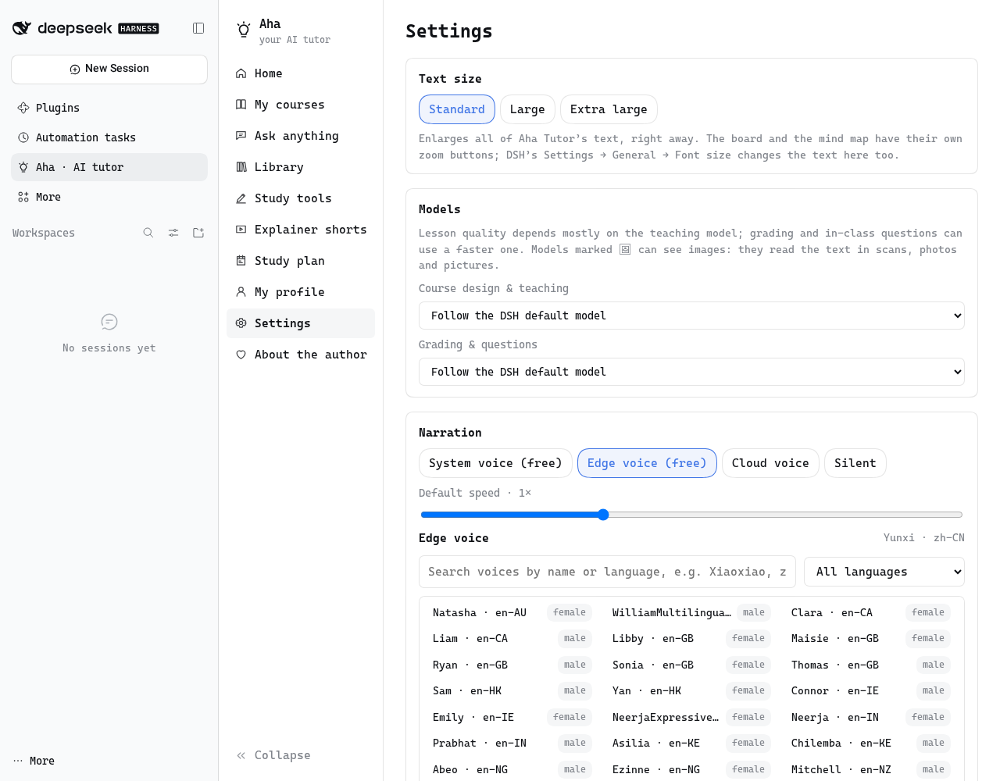
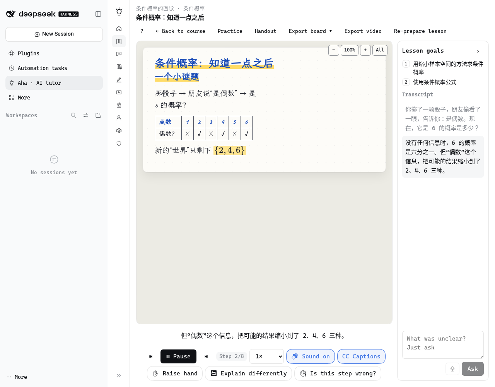

<div align="center">


# 开窍 · AI 私人老师

**简体中文** · [English](README.en.md)

**给 DeepSeek Harness 装一位私人老师：说出你想弄懂的东西，它先了解你，再为你做一门课，在手写黑板上边写边讲。**

[](https://github.com/Wraindrock/dsh-aha-tutor-fork)
[](LICENSE)

[能做什么](#能做什么) · [安装](#安装) · [三分钟上手](#三分钟上手) · [界面预览](#界面预览) · [语音](#语音) · [使用指南](docs/guide.zh-CN.md) · [隐私](#隐私与数据) · [常见问题](#常见问题) · [支持作者](#支持作者)

</div>

<p align="center"></p>

<p align="center"><b>这是 <a href="https://github.com/BaronCyrus/dsh-aha-tutor">BaronCyrus/dsh-aha-tutor</a> 的 fork</b>：保持原有功能，并增加了免密钥的 <b>Edge 在线语音</b>（完整音色库、可搜索）和长讲解自动分段。下面安装的是本 fork，不是 npm 上的上游包。</p>

## 能做什么

| 能力 | 体验 |
| --- | --- |
| **为你定制一门课** | 说一句想学什么，或者丢进一本教材。老师可以先联网查一查这个主题，再用几道选择题了解你的基础、目标、时间和想要的课程规模，再一边写一边展示「单元 → 章 → 讲」的课程蓝图。你可以直接改，可以让老师把一讲拆开或讲深，也可以用一句话让它改（先看修改建议再应用）；开课后还能继续加讲、加单元。确认后生成实战项目和第一单元的练习，后面各讲的练习学到时再出 |
| **手写黑板课堂** | 老师一边讲（语音 + 字幕），一边用手写体在黑板上逐字写下要点、公式、示意图和图表，讲到哪句写哪句，正在讲的内容用荧光笔划出；由公式画的曲线按公式逐点算出，带参数的还能拖动滑块看它怎么变；整讲的板书排在一张能拖动、缩放的画布上，镜头跟着老师走；侧栏显示课堂要点进度和讲解记录；随时暂停、回放、变速 |
| **随堂小测与自适应** | 讲到关键处会停下来考你一题，并问你「有多确定」。猜对、犹豫、自信地答错，会被区别对待；有计算的一讲会请你写出过程，写错了老师就在黑板上订正。学完一讲后，薄弱的知识点会自动加一节巩固课 |
| **举手提问、换个讲法** | 没听懂就举手，老师在黑板上专门回答你，讲完回到原来的进度；问题可以打字，也可以直接说出来（用 DSH 的语音输入在本机识别）；也可以让它用打比方、画图、举例、讲简单点或讲深一点的方式重讲这一步。觉得讲错了就点「这一步不对？」：老师先仔细核对，真错了就在黑板上更正，并把这一讲改好；没错就讲清为什么 |
| **练习、闪卡与复习** | 每讲都有练习，题目可以带示意图，每一题都由老师判（对、部分对还是错都是老师看过你的答案后的判断，不是拿你写的字跟标准答案比对），支持键盘作答；觉得题目或判分有问题就点「这题有问题？」，老师先仔细核对，题错了就改好、重新判分（以前答过的也一起重判）并修正掌握度；做完一组给出星级、掌握程度变化和下一步建议。每个单元有单元测验和单元闪卡，题量和张数按这个单元的知识点来定。闪卡和知识点按间隔重复安排复习，学习计划会自动给复习留出时间 |
| **资料变课程** | 支持 PDF、Word、PPT、Markdown、网页链接和图片；扫描版 PDF、全是图片的文档和拍的照片，由能看图的模型识别出文字。讲课和速查表会引用原文页码；长文档可以一键「消化」成结构、论点和术语表 |
| **速查表、笔记、测验** | 按主题整理的可打印速查表（列数、字号、高亮可调），以及笔记、闪卡组和测验；闪卡和测验会分段读完整份资料，数量按资料长短来定，也可以只出「重点」范围 |
| **讲解短片 + 导出** | 输入一个主题或网址，得到一段约两分钟的白板讲解；任何一讲都能导出成带板书动画、字幕和水印的视频，也能把板书导出成 PDF（一页一张板书，带手写字体和公式）或每页一张的 PNG 图片 |
| **实战项目** | 代码类项目一键生成项目文件夹和起始文件，并在 DSH 里打开一个会话，让编程 Agent 陪你做；做完回来提交，老师按评分标准逐项点评 |
| **学习计划与画像** | 按每周时间、学习日和截止日期自动排课并提示进度风险；月历里学完自动打勾，也能手动勾选，计划随之重排；老师会记住你的背景和薄弱点，你可以随时查看、修改或清空 |
| **对话里也能用** | 新增「开窍 · AI 私人老师」会话预设：在 DSH 对话中，老师可以上白板讲解、出互动小测、帮你建课、做速查表 |

不想先花 token？首页自带两门示例课（「简谐运动」「贝叶斯思维」），打开就能体验完整的黑板课堂。

## 安装

先准备好 **DeepSeek Harness** 桌面版（0.2.1 及以上的 0.2.x 版本），并在 DSH 里配置好至少一个可用的模型。尚未安装 DSH，可查看 [DSH 官方说明](https://github.com/deepseek-ai/deepseek-harness#run)。

1. 打开桌面应用的**插件**页，点击**添加插件**，在**包名或地址**中填入本 fork 的 GitHub 地址：

   ```text
   github:Wraindrock/dsh-aha-tutor-fork
   ```

   点击**安装**。仓库里已经带了构建好的 `lib/`，DSH 直接从 GitHub 安装，不需要你在本地构建。

2. **完全退出并重新打开** DSH 桌面应用。只刷新页面不会加载 Host 端的新插件。

3. 左侧栏出现 **「开窍 · AI 私人老师」**，点开即可使用。

<details>
<summary>离线安装 / 自建 profile / 跟随上游</summary>

- **离线安装**：在仓库里执行 `pnpm install --frozen-lockfile && pnpm run check`，产物是 `.artifacts/dsh-aha-tutor-<版本>.tgz`；在**包名或地址**中填入它的绝对路径即可。
- **自建 profile**：`dsh plugin --profile <name> add github:Wraindrock/dsh-aha-tutor-fork`；本地改动用 `link:<仓库绝对路径>`。不要对 `desktop` profile 使用这条命令，桌面版请走插件页。
- **只想用上游原版**：把地址换成 `github:BaronCyrus/dsh-aha-tutor`，或在插件页填 `dsh-aha-tutor` 从 npm 官方源安装。npm 上只有上游包，没有本 fork。

</details>

## 三分钟上手

1. **说出目标**：在首页输入「三周内搞懂线性代数里的特征值」，或附上一份讲义，点**开始**。
2. **回答几个问题**：选一选你的基础、目的和节奏，点**生成课程蓝图**。不满意就直接改，或者写一句「多加一些编程练习」。
3. **确认开课**：点**确认，生成整门课**，然后在课程页点**继续学习**，老师就会在黑板上开讲。

想快速问一个概念、解一道题、看一张图？用首页的「讲个概念」「陪我解题」「画出来看看」，不用建课。

## 界面预览

| 首页 | 黑板课堂 |
| --- | --- |
|  |  |
| **随堂小测** | **导出的讲解视频** |
|  |  |

## 语音

| 方式 | 说明 |
| --- | --- |
| **系统语音（默认，免费）** | 使用 macOS / Windows 自带的音色，可在设置中挑选；系统没有中文音色时会给出提示 |
| **Edge 在线语音（免费，无需密钥）** | 用微软 Edge 的在线朗读服务合成，联网即可，不用注册或填密钥；音色库里有三百多个音色，可以按名称或语言搜索，选中后点「试听」就能听；长讲解按朗读时长自动分段（每段约三分钟以内）再拼回一段音频，两分钟、二十分钟的讲解都能用；合成过的语音缓存在本机，重播不再请求。这是 Edge 的一项非公开接口，微软调整服务时可能暂时用不了 |
| **云端语音（可选）** | 支持 OpenAI 兼容接口（含硅基流动等）、火山引擎（豆包语音）、MiniMax、Azure 语音。密钥保存在 DSH 的凭据库中，只在 Host 端使用，不会传给浏览器；合成过的语音会缓存在本机，重播不再计费 |

| 设置里的 Edge 音色库 | 用 Edge 语音朗读的课堂 |
| --- | --- |
|  |  |

导出视频时，只有 Edge 在线语音和云端语音能被录进视频；用系统语音导出的视频带字幕、没有声音。黑板上的小动画在视频里以一帧静态画面出现。

## 模型

默认使用你在 DSH 里设置的默认模型。在 **开窍 → 设置** 里，可以分别为「出课与讲课」和「批改与问答」指定模型，例如出课用更强的模型、批改用更快的模型。

插件不会自动切换到其它付费模型，也不会在后台批量消耗额度：课程结构在你确认时生成，每一讲的板书在你打开时才生成（同时预备下一讲），后面各讲的练习也在打开时才生成。使用订阅类模型时，请遵守对应服务的使用条款。

## 隐私与数据

- 课程、进度、资料、画像和学习计划都保存在本机：`$DSH_HOME/aha-tutor/`（默认 `~/.dsh/aha-tutor/`，Windows 为 `C:\Users\<用户名>\.dsh\aha-tutor\`）。
- 实战项目的文件夹在 `~/AhaTutor/projects/` 下，插件不会覆盖你已经改过的文件。
- 发给模型的内容只有完成当前任务所需的部分：你的问题、课程结构、相关的资料片段，以及简短的学习画像。
- 网页导入只抓取公开地址，不访问本机或局域网地址；连接时会再次核对网址解析出的每一个地址。
- 模型生成的示意图会经过白名单过滤；动画运行在无网络权限的沙箱里。

详见 [SECURITY.md](SECURITY.md)。

## 更新与卸载

**开窍 → 设置 → 插件版本**会检查版本。用 GitHub 地址或 `link:` 安装时，它不会把插件换成 npm 上的上游包：

- `link:` 安装（本地检出）显示「本地开发安装」：在仓库里 `git pull`，执行 `pnpm install --frozen-lockfile && pnpm run check`，再完全退出并重新打开 DSH。
- GitHub 地址安装：重新在插件页安装 `github:Wraindrock/dsh-aha-tutor-fork`（自建 profile 里再执行一次 `dsh plugin --profile <name> add github:Wraindrock/dsh-aha-tutor-fork`），然后重开 DSH。

设置页的版本检查查的是 npm 上的上游包 `dsh-aha-tutor`，所以上游发版后这里可能提示「发现新版本」；本 fork 的更新方式只有上面两种，不要按提示安装 `dsh-aha-tutor@<版本>`，那会装回上游包。

在桌面应用的**插件**页可以停用或卸载插件。卸载不会删除 `~/.dsh/aha-tutor/` 里的学习数据；不再需要时可以手动删除这个文件夹。

## 常见问题

**老师没有声音？** 打开 **开窍 → 设置 → 语音讲解**，点**试听**。没有中文音色时，可在系统设置里安装中文语音，或改用 **Edge 在线语音（免费）**，也可以配置云端语音。

**生成失败或结果不理想？** 点**重试**，或在设置里为「出课与讲课」换一个更强的模型。

**扫描版 PDF 读不出字？** 扫描页由你选的模型识别，需要能看图的模型（开窍设置里带 🖼 的，比如 DeepSeek-V4.1-Flash）。上传时会显示识别到第几页，可以随时取消；一个文件最多识别 200 页。

**会话里怎么用老师？** 新建会话时，在预设里选择 **「开窍 · AI 私人老师」**。

## 开发

```bash
pnpm install --frozen-lockfile
pnpm run check
```

`pnpm run check` 会依次运行全部测试、构建 Host 与浏览器端的包，并在 `.artifacts/` 下打出 tgz。本地开发时，可在 DSH 插件页填入仓库的绝对路径，以 `link:` 方式安装。改动 Host 代码后，需要重启 DSH 才能生效。仓库结构与约定见 [AGENTS.md](AGENTS.md)。

## 许可

[MIT](LICENSE) © BaronCyrus。第三方组件的许可见 [THIRD_PARTY_NOTICES.md](THIRD_PARTY_NOTICES.md)。本 fork 在 [Wraindrock/dsh-aha-tutor-fork](https://github.com/Wraindrock/dsh-aha-tutor-fork) 维护。

「开窍 / Aha Tutor」是独立的开源项目，与 DeepSeek 或其他任何学习产品均无隶属关系。

## 支持作者

开窍免费开源，赞赏全凭心意。如果它帮你弄懂了某个卡了很久的知识点，欢迎扫码支持，让小窍继续长大。

<table align="center">
  <tr>
    <td align="center"><br><b>微信赞赏</b></td>
    <td align="center"><br><b>支付宝</b></td>
  </tr>
</table>
